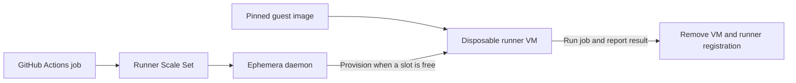

# Ephemera

**Self-hosted GitHub Actions runners in disposable VMs.**

[](https://github.com/illusions-lab/Ephemera/actions/workflows/ci.yml)
[](https://github.com/illusions-lab/Ephemera/releases/latest)

Ephemera connects to GitHub through a GitHub App and Runner Scale Sets. Each job gets a fresh VM from a pinned image on your Ubuntu host or Apple Silicon Mac. Ephemera starts the official Runner, limits concurrency, and removes the VM and writable disk when the job finishes.

[Install on Linux](#linux) · [Install on macOS](#macos) · [Architecture](ARCHITECTURE.md) · [Contribute](CONTRIBUTING.md)

## Quick Start

### Linux

**Recommended AMD64 host:** A 10th-generation Intel Core i5 or newer with 32 GB of RAM. Install Ubuntu Server 24.04 LTS directly on the hardware and use KVM for job VMs.

Ubuntu Server 24.04 LTS is our validated Linux host on AMD64 and ARM64. Ephemera's Linux GitHub Actions runner image tooling is built and tested around Ubuntu. Debian and Red Hat Enterprise Linux have yet to be validated as runner hosts.

Install the [image build tools](#runner-images-and-readiness) for your architecture before enabling job execution. If the latest release has no archive for your architecture, [install a candidate from source](#install-a-candidate-from-source).

```sh
curl -fsSL https://github.com/illusions-lab/Ephemera/releases/latest/download/install.sh -o install.sh &&
  sudo bash install.sh
```

The installer opens setup on a fresh interactive install. If you closed it or installed without a terminal, run `sudo ephe setup`. Open the setup link, create and install the GitHub App on your organization or repository, verify it in the browser, then return to the terminal to save the configuration and start the service.

```sh
ephe status
sudo ephe doctor
```

### macOS

**Recommended host:** An Apple M2 or newer with at least 16 GB of memory, running macOS 26 or newer. An M4 with 32 GB is ideal.

My own host is an M2 Mac mini with 8 GB. Mac prices made that decision for me. It runs my jobs, and macOS still makes an awkward server.

Open Terminal as the account that will run Ephemera. The latest public release may lack a macOS bundle. If its assets do not include `install-macos.sh`, [install a candidate from source](#install-a-candidate-from-source).

```sh
curl -fsSL https://github.com/illusions-lab/Ephemera/releases/latest/download/install-macos.sh -o install-macos.sh &&
  /bin/bash install-macos.sh
```

Follow the GitHub App setup prompts. The installer prints how to add `ephe` to your PATH if needed.

```sh
ephe status
ephe doctor
```

See the [macOS installation guide](packaging/macos/README.md) for dedicated-server power settings, upgrades, and recovery.

### Windows hosts

Windows hosts are outside Ephemera's support scope and roadmap. In our tests on the same hardware, Windows delivered noticeably lower throughput than Linux. Use Ubuntu or Apple Silicon macOS as the host. Windows guest VMs on Linux are planned.

### Run a test workflow

New installations start in observation mode. Confirm the GitHub connection with `ephe status`, then use a **dedicated test Scale Set** for [execution acceptance](#test-qemu-execution). Set `runner.execute: true` in the host configuration and apply it through `sudo ephe setup` on Linux or `ephe setup` on macOS.

Set your workflow's `runs-on` to the Scale Set name shown by `ephe status`. Replace the example below with your own name.

```yaml
name: Ephemera smoke test
on: workflow_dispatch

jobs:
  smoke:
    runs-on: ephemera-ubuntu-amd64
    steps:
      - run: uname -sm
```

Use `ephe status --watch` to follow job intake, VM startup, and cleanup.

## How it works



With execution enabled, `ephemerad` provisions a VM when there is job demand and a runner slot is free. The guest starts the official GitHub Actions Runner with a just-in-time configuration. After the job finishes, Ephemera removes the VM and its writable state and reconciles the runner registration.

The [architecture document](ARCHITECTURE.md#runner-execution-design) covers scheduling, VM backend contracts, and restart recovery.

## Configuration and operation

| | Linux | macOS |
| --- | --- | --- |
| Configuration | `/etc/ephemera/config.yaml` | `~/Library/Application Support/Ephemera/config.yaml` |
| Setup and apply | `sudo ephe setup` | `ephe setup` |
| Diagnostics | `sudo ephe doctor` | `ephe doctor` |
| Service logs | `sudo journalctl -u ephemera.service -f` | `tail -F "$HOME/Library/Logs/Ephemera/daemon.log"` |

On Linux, systemd-journald rotates and prunes service logs according to the host
policy. It stores persistent journals under `/var/log/journal` and volatile
journals under `/run/log/journal`. Upstream defaults limit shared journal use to
10% of the filesystem, capped at 4 GiB, subject to available space and local
configuration. See [journald.conf](https://www.freedesktop.org/software/systemd/man/latest/journald.conf.html).

On macOS, Ephemera rotates the service log at 10 MiB, keeps up to five gzip
archives, and prunes archives older than 14 days when opening or rotating the
log. After upgrading, logs from older versions can still be read at
`~/Library/Application Support/Ephemera/logs/daemon.log`.

`ephe status` shows the service, GitHub connection, intake mode, and latest job counts. Use `--watch` for continuous updates and `--json` for scripts. Together they emit one JSON object per refresh. If the daemon socket is unavailable, the CLI reports the supervisor state and marks live data as unavailable.

`ephe doctor` checks configuration, GitHub App access, Scale Set connectivity, and the selected VM backend. On Linux it also checks the image cache, QEMU/KVM, and disk space. It never claims jobs or creates a Scale Set.

### GitHub App setup

Enter your organization name, `owner/repository`, or a full GitHub URL in the wizard. Ephemera suggests an App name using the host name and a short numeric suffix. Set the Scale Set name under **Advanced settings**. The browser walks through App creation, installation, and verification. After saving, the terminal shows the verified App and installation details.

On Linux, headless setup can provide a temporary Cloudflare Quick Tunnel link with SSH forwarding as an alternative. The tunnel closes when setup finishes, is canceled, or times out. If you already have an App, run setup with `--existing-app` and provide its IDs and PEM path.

### Runner images and readiness

| Guest image | Architecture | Base image and backend |
| --- | --- | --- |
| Ubuntu 24.04 (`ubuntu-24.04`, `ubuntu-latest` in the setup catalog) | AMD64 | Ubuntu cloud image, QEMU/KVM on a matching Linux host |
| Ubuntu 24.04 (`ubuntu-24.04-arm`) | ARM64 | Ubuntu cloud image, QEMU/KVM on a matching Linux host |
| macOS Tahoe | ARM64 | Digest-pinned Cirrus Labs Tart image, Tart on Apple Silicon |
| Windows | AMD64 planned | QEMU on Linux |

GitHub publishes its hosted image catalog, build definitions, and provisioning scripts in [`actions/runner-images`](https://github.com/actions/runner-images). It publishes the official Runner packages used by Ephemera in [`actions/runner`](https://github.com/actions/runner/releases).

On Linux, Ephemera uses its own image recipe for the host architecture. It downloads and verifies the pinned Ubuntu cloud image and GitHub Runner package, runs the dependency installer bundled with the Runner, and assembles and boot-tests a QCOW2 base disk for job VMs. On macOS, Tart pulls the pinned base image, and Ephemera prepares it with the official macOS ARM64 Runner before cloning it for jobs.

Install the Linux image tools for the host architecture:

```sh
# AMD64
sudo apt install qemu-system-x86 qemu-utils guestfs-tools cloud-image-utils
# ARM64
sudo apt install qemu-system-arm qemu-efi-aarch64 qemu-utils guestfs-tools cloud-image-utils
```

Run `sudo ephe image prepare` to build or verify the selected image. Linux caches validated disks under `/var/lib/ephemera/image` and uses copy-on-write overlays for jobs. To change source pins, update `image.ubuntu.amd64` or `image.ubuntu.arm64` in the [example configuration](configs/ephemera.example.yaml). If libguestfs stalls on a nested host, try `LIBGUESTFS_BACKEND_SETTINGS=force_tcg` for image preparation. Job execution still requires KVM.

The Linux setup wizard maps the Ubuntu 24.04 catalog entries above to Ephemera's recipes. Use the [official image catalog](https://github.com/actions/runner-images#available-images) to look up tools preinstalled in GitHub's hosted images.

## Upgrades and unattended installation

On Linux, staged updates leave the current service running until you apply them:

```sh
ephe update --check
sudo ephe update
sudo ephe update --apply
```

The installer verifies the release checksum and rolls back the active version and service state if activation fails. Configuration, credentials, and the image cache are retained. The installer accepts `--version TAG` for a pinned release and `--bundle DIR` for an offline bundle.

For unattended Linux installation with an existing App:

```sh
sudo bash scripts/install.sh --non-interactive \
  --config /path/to/config.yaml --github-app-key /path/to/github-app.pem
```

On upgrades, omit the configuration and key paths to reuse the installed files. If the first installation saved those files but failed to start the service, rerun with the same inputs after fixing the startup problem.

On macOS, rerun the installer to upgrade. See the [macOS guide](packaging/macos/README.md) for unattended setup and activation rollback.

## Build and test

Run `make` for available targets and `make check` for the standard Go, shell, and configuration checks. Use `make build` to build the local CLI and daemon in `bin/`.

### Install a candidate from source

On an Ubuntu host with Go and Make installed, build and install for the host architecture:

```sh
make bundle-linux LINUX_ARCH=arm64  # use amd64 on x86-64
sudo bash scripts/install.sh --bundle bin/bundle
```

On Apple Silicon, run `make bundle-macos`. Follow the [local bundle instructions](packaging/macos/README.md) to install the matching pinned Tart dependency, then run:

```sh
/bin/bash scripts/install-macos.sh --bundle bin/macos-bundle
```

To exercise the browser setup against a test GitHub organization or repository without installing a service:

```sh
go run ./cmd/ephemera setup --local-dir "$(mktemp -d)"
```

The wizard creates a real GitHub App when you confirm it on GitHub and saves credentials in the printed directory. Delete the test App and remove the test credentials when finished.

### Test QEMU execution

Use a Linux KVM host and dedicated test Scale Set for each architecture. The packaged service runs as `ephemera` and keeps instance records, overlays, and private bootstrap data under `/var/lib/ephemera/instances`. Give the service account access to KVM and the image cache, and isolate the management network from guest traffic.

Dispatch the [dedicated Scale Set acceptance workflow](.github/workflows/execution-acceptance.yml) with `guest_os=linux`, the matching `arch`, and the Scale Set label. Set `runner.max_concurrent: 2` for the overlap case. Follow the [macOS acceptance steps](packaging/macos/README.md) for Tart.

1. Run one job, then repeat with overlapping jobs. Check that runner names, instance IDs, and boot IDs differ.
2. Exercise a startup or registration failure. Restore the dependency and verify retry and cleanup.
3. Test both a graceful restart and an abrupt daemon exit during a job. Check that recovery removes leftover resources before intake resumes and that a subsequent job completes.
4. Exercise a transient cleanup failure. Confirm the instance keeps its slot until cleanup succeeds.
5. Confirm the base image is unchanged and GitHub has no stale runner registrations.

Record the candidate commit, daemon version, Scale Set label, and workflow run for each platform. Release publishing runs through GitHub Actions. CI verifies the bundles, with Ubuntu VM acceptance and native macOS installer checks running separately.

For a disposable Linux installer smoke test, use `make vm-test DEBIAN_IMAGE=... DEBIAN_SHA512=...` with a versioned Debian genericcloud AMD64 QCOW2 and its SHA-512. `make vm-debug` retains the test VM and prints its SSH command.

## Roadmap

### Implemented

- [x] GitHub App authentication, Scale Set job intake, and configurable concurrency
- [x] Ubuntu 24.04 image preparation, caching, and offline boot verification on AMD64 and ARM64
- [x] QEMU/KVM job VMs with copy-on-write disks, automatic cleanup, and crash recovery
- [x] Apple Silicon installer, Tart guest bootstrap, and native CI checks

### Live acceptance

- [ ] Run jobs on a dedicated GitHub Scale Set with Ubuntu 24.04 QEMU/KVM guests on AMD64 and ARM64
- [ ] Run jobs and verify crash recovery on a dedicated GitHub Scale Set with macOS ARM64 Tart guests

### Planned

- [ ] Windows AMD64 guest image preparation and boot verification on Linux
- [ ] Remote host agents and multi-host scheduling
- [ ] Runner pools
- [ ] Optional VM snapshot and restore acceleration

## License

[Apache License 2.0](LICENSE)
